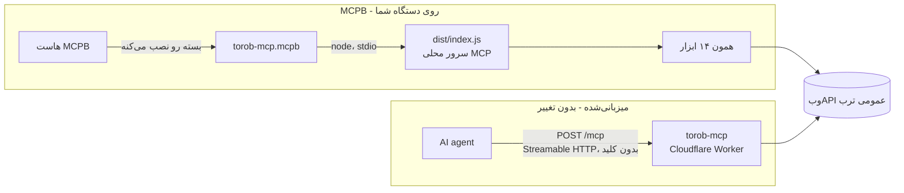
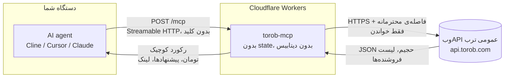

# ترب MCP - هوش مقایسه قیمت برای ایجنت‌ها


[](https://github.com/mmdju/torob-mcp/actions/workflows/verify.yml)


**دانش واقعی ترب برای ایجنت‌های هوش مصنوعی.** جستجو تو **موتور مقایسه قیمت ایران** با هر MCP کلاینتی (Cline، Cursor، Claude Desktop...): **قیمت به تومان**، قیمت همه‌ی فروشنده‌های یک محصول، تاریخچه قیمت، راهنمای خودِ ترب، پروفایل فروشنده‌ها، پیشنهادهای ویژه‌ی امروز. **فقط خواندنیه، بدون کلید، بدون لاگین** - و جواب‌ها به‌جای اون صفحه‌ی ۷۰ کیلوبایتی، چند کیلوبایت بیشتر نیستن.

**آدرس زنده:** `https://torob-mcp.mmdju3.workers.dev/mcp` (Streamable HTTP، بدون state) - اگه همین آدرس رو بدون `/mcp` تو مرورگر باز کنی [سایت](https://torob-mcp.mmdju3.workers.dev/) رو می‌بینی. `GET /mcp` به مرورگر صفحه‌ی راهنمای اتصال رو می‌ده و به هر کلاینت دیگه‌ای `405` - همون جوابی که استاندارد MCP می‌خواد، تا هیچ کلاینتی اون صفحه رو مثل یک جریان بازشده و تموم‌شده نخونه.

> [!IMPORTANT]
> **نسخهٔ میزبانی‌شده، نسخهٔ اصلی نیست - یه دموی تست سریعه.** روی کلادفلر اجرا می‌شه و ترب بعضی آدرس‌ها رو مستقیم چالش میده، برای همین **محدودیت داره (۲۰ درخواست به `/mcp` در دقیقه به‌ازای هر IP)** و **هر چند وقت یک‌بار موقتاً متوقف می‌شه**. برای استفادهٔ جدی، نسخهٔ اصلی رو روی سیستم خودت اجرا کن (پایین‌تر): نه محدودیتی از طرف ماست، نه درخواست‌ها از اتصال تو نیست. ببین [وضعیت](#وضعیت).

**[English version](README.md)** · **[مثال‌ها](examples/sample-calls.md)** · **[مرجع ابزارها](docs/tools.md)** · **[تغییرات](CHANGELOG.md)**

## اتصال در ۳۰ ثانیه

هر MCP کلاینتی، **فقط یه آدرس**. Cline / Cursor / Claude Desktop (استایل `mcp.json`):

```json
{
  "mcpServers": {
    "torob": { "url": "https://torob-mcp.mmdju3.workers.dev/mcp" }
  }
}
```

بعدش فقط حرف بزن: **«ارزون‌ترین آیفون ۱۳ کجاست؟»**، **«هدفون زیر ۱۰ میلیون»**، **«این گوشی رو کجا بخرم بهتره؟»**، **«چی تخفیف خورده؟»**.

دستت به کلاینت نمی‌رسه؟ کل پروتکل یه POST بیشتر نیست - یه فراخوانی واقعی:

```bash
curl -sS https://torob-mcp.mmdju3.workers.dev/mcp \
  -H 'content-type: application/json' \
  -H 'accept: application/json, text/event-stream' \
  -d '{"jsonrpc":"2.0","id":1,"method":"tools/call","params":{"name":"search_products","arguments":{"query":"هدفون بی سیم","limit":2}}}'
```

و جوابی که تو همون یه پیام برمی‌گرده، بُریده‌شده تا استخوان:

```json
{
  "query": "هدفون بی سیم",
  "total_matches": 412,
  "total_matches_note": "Torob's own count is approximate - it changes between identical requests - so page with has_next_page rather than trusting the number.",
  "price_range_toman": { "min": 98000, "max": 2500000 },
  "products": [
    {
      "prk": "prk-a1b2c3d4-0000-4000-8000-000000000001",
      "name_fa": "هدفون بی‌سیم مدل P47",
      "price_toman": 238970,
      "available": true,
      "shop_name": "فروشگاه لوازم دیجیتال",
      "url": "https://torob.com/p/prk-a1b2c3d4-0000-4000-8000-000000000001/",
      "details_url": "https://api.torob.com/v4/base-product/details/?search_id=s1&prk=prk-a1b2c3d4-0000-4000-8000-000000000001"
    },
    {
      "prk": "prk-a1b2c3d4-0000-4000-8000-000000000002",
      "name_fa": "هدفون بلوتوثی مدل P9",
      "price_toman": 410000,
      "available": true,
      "shop_name": "پخش عمومی صوت",
      "url": "https://torob.com/p/prk-a1b2c3d4-0000-4000-8000-000000000002/"
    }
  ],
  "attribution": "Data comes from Torob's public web API. Prices, stock and seller offers change constantly - always confirm on torob.com before buying."
}
```

کلاینت‌های MCP توی مرورگر هم کار می‌کنن - endpoint جواب preflight مرورگر (`OPTIONS /mcp`) رو می‌ده.

### یا لوکال، روی خودِ ماشینت اجراش کن

همون ۱۵ ابزار، ولی به‌عنوان یک **پروسهٔ محلی** — نه endpointِ ما، نه محدودیتِ نرخِ خودمون. هر چیزی که یه اجرا یاد می‌گیره می‌ره توی `~/.torob-mcp/state.json`: اسم و لینکِ محصولاتی که پیدا کرد، و دیواری که داره صبرش می‌کنه. ری‌استارت هر دو رو نگه می‌داره؛ پاک کردنِ اون فایل همه‌چیز رو از نو شروع می‌کنه.

یک خط — بار اول کُندتره چون npm می‌سازتش، و باید `git` نصب باشه، چون یکی از وابستگی‌ها (`fa-text-utils`) از یک مخزنِ گیت میاد:

```json
{
  "mcpServers": {
    "torob": { "command": "npx", "args": ["-y", "github:mmdju/torob-mcp"] }
  }
}
```

یا از یک کلون، اگه دوست داری کدی رو اجرا کنی که خودت می‌تونی بخونیش:

```bash
git clone https://github.com/mmdju/torob-mcp.git
cd torob-mcp && npm install      # اسکریپتِ prepare خودش dist/ رو می‌سازه
```

```json
{
  "mcpServers": {
    "torob": { "command": "node", "args": ["/path/to/torob-mcp/dist/index.js"] }
  }
}
```

### درست استفاده کردن

- **همه‌ی قیمت‌ها تومانن** (۱ تومان = ۱۰ ریال). قیمت، موجودی و درجه‌ی فروشگاه **مدام عوض می‌شه** - همیشه لینک محصول رو بده تا کاربر خودش چک کنه.
- **کارت سرچ یه قیمته - ارزون‌ترین پیشنهاد.** `product_details` اون callـیه که همه‌ی فروشنده‌ها رو لیست می‌کنه، و `price_spread_toman` بینشون دقیقاً همون چیزیه که دلیل وجود یه سایت مقایسه قیمته. فروشگاه‌های **حضوری** رو هم می‌ده، با تاریخِ آخرین تغییر هر قیمت - پس اگه قدیمیه بگو.
- **`url` یه کارت، صفحه‌ی فروشگاه توی torob.comه.** لینکِ دکمهٔ خرید یه ریدایرکت ردیابی‌شده‌ی `api.torob.comه` که جدا با `buy_url` میاد - `url` رو تو جواب نگه دار، `buy_url` رو فقط وقتی بده که کاربر داره کلیک می‌کنه.
- **`price_history` چکِ صداقتِ قیمته.** قیمت امروز رو با نمودار خود ترب مقایسه کن؛ اسم سری‌ها مال خود تربه، پس همون‌ها رو نقل کن و از خودت روند نساز.
- **`price_toman: null` یعنی موجود نیست**، هیچ‌وقت ۰ نیست، و **۰ هیچ‌وقت رایگان نیست**: «ناموجود» خود ترب میاد با `available: false`. و **`price_unreliable: true`** یعنی خود ترب می‌گه این قیمت قابل اعتماد نیست - هشدار رو منتقل کن، به‌عنوان پیشنهاد خوب معرفیش نکن.
- **درجه‌ی فروشگاه بدون تعداد رأی معنی نداره.** `shop_score: 5` با `shop_votes: 0` عادیه یعنی «هنوز رأیی نخورده»، نه «فروشگاه پنج‌ستاره».
- **نتیجه‌ی خالی ثابت نمی‌کنه محصول وجود نداره.** جواب با خودش `query_note` و `suggested_queries` ترب رو می‌آره - با یکی از اون‌ها دوباره امتحان کن، به‌جای اینکه به کاربر بگی موجود نیست.
- **فیلتر یا مقدار ناشناخته با فیلترهای واقعی رد می‌شه** (`available_filters` مقادیر مجاز هر گروه رو داره). ترب اون چیزی رو که نشناسه نادیده می‌گیره و **بدون فیلتر** جواب می‌ده - برای همینه که این سرور اول رد می‌کنه.
- **ترب به کلاینتی که تند صدا بزنه، به‌جای داده چالش رباتی می‌ده.** سرور صریح می‌گه چی شده، هیچ‌وقت حل یا دورش نمی‌کنه، و بقیه‌ی یه هجوم رو تا آخرِ مهلت نگه می‌داره. جزئیات تو [SECURITY.md](SECURITY.md).
- نتیجه‌ها **سقف دارن** (پیش‌فرض ۱۰؛ سقفِ خودِ هر ابزار توی [docs/tools.md](docs/tools.md)) برای حفظ کانتکست ایجنت، و فارسی موقع مقایسه‌ی اسم‌ها فولد می‌شه (ی/ک عربی، ارقام مخلوط، نیم‌فاصله) - خود کوئری بدون تغییر به ترب می‌ره.
- **[examples/sample-calls.md](examples/sample-calls.md)** یازده مکالمه‌ی آماده‌ی کپی-پیست داره، **[docs/tools.md](docs/tools.md)** همه‌ی پارامترها و اسلاگ فیلترها رو، و **[docs/card.d.ts](docs/card.d.ts)** تایپ خروجی‌ها رو.

## بستهٔ MCPB

سرور محلی به‌شکل **یک فایل**. **MCP** پروتکلیه که ایجنت و سرور باهاش حرف می‌زنن. **MCPB** بسته‌ایه که اون سرور داخلش تحویل داده می‌شه - همون یک فایلی که هاست نصب می‌کنه و بدون build، بدون `git` و بدون جمع‌کردنِ `node_modules`، یه سرور MCP محلی به دست می‌آره. هم قالب و هم پسوندش از DXT تغییر نام دادن؛ این مخزن `.mcpb` می‌سازه.

### دو راه برای رسیدن به همون ۱۴ ابزار

MCPB مسیر **محلی**ه. جای دیپلوی میزبانی‌شده رو نمی‌گیره، و هیچ‌چیز تو این بخش اون رو عوض نمی‌کنه.



- **ریموت** - یه آدرس، بدون نصب، زیرساختِ مشترک، و محدودیتِ ۲۰ درخواست در دقیقه که پایین‌تر، تو بخش وضعیت، توضیح داده شده.
- **MCPB** - بدون endpointِ ما تو مسیر، و بدون محدودیتِ ما. فاصله‌گذاری و دیوارِ رباتی ترب همچنان اعمال می‌شه، چون این درخواست‌ها همچنان درخواست‌های تربن.

### بساز و نصب کن

```bash
git clone https://github.com/mmdju/torob-mcp.git
cd torob-mcp
npm ci               # یا npm install - اسکریپتِ prepare خودش dist/ رو می‌سازه
npm run build:mcpb   # -> build/torob-mcp.mcpb
```

خروجی همون `build/torob-mcp.mcpb`ـه. هاستی که MCPB رو می‌فهمه، از مسیر import بستهٔ خودش نصبش می‌کنه - فایل رو بهش نشون بده - و بعد دقیقاً همون‌طور که manifest می‌گه اجراش می‌کنه. هیچ ورودی رجیستری، هیچ کانال آپدیت و هیچ فایل ازپیش‌ساخته‌ای از این مخزن منتشر نمی‌شه: **خودت می‌سازیش**، پس چیزی که نصب می‌کنی همون کدِ کلونیه که خودت می‌تونی بخونیش.

قبل از اینکه چیزی نصب کنی، نگاه کن داخلش چیه:

```bash
npx mcpb info build/torob-mcp.mcpb
# File: torob-mcp.mcpb
# Size: 4031.82 KB
# WARNING: Not signed
```

بسته **امضا نشده**، و اینجا هم وانمود نمی‌کنیم که هست: بیلد امضا نمی‌کنه، `mcpb sign` کلیدی می‌خواد که این پروژه نداره، و هاستی که امضا بخواد بسته رو رد می‌کنه.

### بیلد واقعاً چیکار می‌کنه

`npm run build:mcpb` اول `tsc` رو اجرا می‌کنه و بعد `node scripts/build-mcpb.mjs` رو. این اسکریپت:

1. **پوشهٔ staging یعنی `build/mcpb/` رو از صفر می‌سازه**، پس فایلی که از سورس پاک شده نمی‌تونه تو بسته زنده بمونه.
2. **ایمپورت‌های entry point رو دنبال می‌کنه.** از `dist/index.js` شروع می‌کنه و ایمپورت‌های نسبیِ ثابت رو دنبال می‌کنه و هر ماژولی رو که می‌رسه کپی می‌کنه - یازده تا. `dist/` هم بیلد Node رو داره هم بیلد Worker، پس همین دنبال‌کردنه که `worker.js`، `rate-limit.js`، `og-image.js` و `fonts.js` رو بیرون نگه می‌داره؛ ایمپورتی که resolve نشه خطای بیلده، نه بستهٔ خراب تو هستِ یکی.
3. **درختِ وابستگی‌های production رو کپی می‌کنه** از همون `node_modules`ـی که npm ساخته، با جواب خود npm به این سؤال که «این پکیج برای اجرا چی می‌خواد» (`npm ls --omit=dev`)، و با کنار گذاشتن چیزهایی که npm اضافه گزارش می‌کنه (`extraneous`). بسته بیرون از هر نصبی `node` رو اجرا می‌کنه، پس باید همراهش بیاره.
4. **دو فایل از خودش می‌نویسه**: یه `package.json` کم‌وکم - `"type": "module"` اختیاری نیست، چون `dist/*.js` ماژول ES هستن و Node وگرنه entry رو CommonJS می‌خونه و روی همون اولین import می‌مکه - و manifest، با `version`ـی که از `package.json` گرفته شده. `.mcpbignore` هم همراه پوشهٔ staging میاد.
5. **پوشه رو به CLI رسمی می‌ده.** `@anthropic-ai/mcpb` به‌عنوان devDependency با نسخهٔ دقیق پین شده و از `node_modules` پیدا می‌شه، پس خروجی هیچ‌وقت به چیزی که یه ماشین سراسری نصب کرده وابسته نیست. CLI خودش اعتبارسنجی می‌کنه (`mcpb validate`) و بسته‌بندی می‌کنه (`mcpb pack`).
6. **آرشیو رو دوباره می‌خونه.** همون چیزی رو که همین حالا نوشته باز می‌کنه (`mcpb unpack`) و بعد چک می‌کنه که هر فایل لازم سر جاشه - `manifest.json`، `package.json`، خود entry، `dist/server.js`، `dist/tools.js`، `dist/project.js` و هر دو وابستگی زمان‌اجرا - نسخهٔ manifest با `package.json` یکیه، و هیچ‌چیزِ ممناهی همراهش نیومده: `.env*`، `.dev.vars`، `.git`، `node_modules/.bin`، `tsconfig.json`، `package-lock.json`، `*.pem`، `*.key`، `*.mcpb`، `*.tgz`، `*.log`، `*.map` یا ماژول‌های مخصوص Worker. هر کدوم از اینا بیلد رو رد می‌کنه.

به یه `node_modules` از قبل موجود نیاز داره؛ خودش چیزی نصب نمی‌کنه، از شبکه استفاده نمی‌کنه و git صدا نمی‌زنه. نتیجه: حدود ۱۲ مگابایت باز، کمتر از ۴ مگابایت فشرده، که تقریباً همه‌ش SDK مک‌پی و وابستگی‌هایشه. `build/` تو `.gitignore`ـه - بسته آرتیفکته، نه فایل سورس.

### داخل بسته چیه

```text
build/torob-mcp.mcpb
├── manifest.json        اسم، نسخه، توضیح، سازگاری، اسم ۱۴ ابزار
├── package.json         کم‌وکم: type: module، به‌علاوهٔ فهرست وابستگی‌های زمان‌اجرا
├── dist/                یازده ماژولی که dist/index.js ایمپورت می‌کنه
│   ├── index.js         entry point محلی - پیش‌فرض stdio، با --http هم می‌شه
│   ├── server.js        buildServer() - همون کدی که ورکر هم اجرا می‌کنه
│   ├── tools.js         چهارده ابزار
│   ├── project.js       لایهٔ پروجکشن
│   └── …
└── node_modules/        درختِ وابستگی‌های زمان‌اجرا (۹۵ پکیج)
```

عمداً داخلش نیست: `src/`، `tests/`، `scripts/`، `docs/`، `landing/`، `assets/`، `.github/`، `.wrangler/`، بیلد ورکر، `.env*`، کلید و گواهی، lockfile و `node_modules/.bin`. روی این‌ها، خود CLI هم `.git`، `*.d.ts` و source map‌ها رو حذف می‌کنه، و `.mcpbignore` یه لایهٔ دوم دفاعه - با اینکه فهرست staging از قبل این مسیرها رو کنار گذاشته - تا یه تغییر تو کدِ staging نتونه از روی اشتباه secretی رو روانه کنه، و تا `mcpb pack .` تو یه کلون هم امن باشه.

### همون سروره، نه یه پیاده‌سازی دوم

این تصمیمیه که ارزش دونستن داره: **بسته هیچ پیاده‌سازی دومی از هیچ‌چیز نداره.** همون `dist/index.js` رو اجرا می‌کنه - همون entry pointـی که `node dist/index.js` از اول اجرا می‌کرده - روی stdio، با `${__dirname}` که به همون‌جایی اشاره می‌کنه که هاست بازش کرده.

```text
                  MCPB
                    │
                    ▼
          ${__dirname}/dist/index.js
                    │
                    ▼
          buildServer()  ← src/server.ts، مشترک با ورکر
                    │
            ┌───────┴───────┐
            ▼               ▼
       ۱۴ ابزار        وب‌API عمومی ترب
```

پس ابزارها، لایهٔ پروجکشن، یکپارچگی با ترب، فاصله‌گذاری و دروازهٔ دیوار رباتی، تو هر استقراری همون کدن. نسخهٔ محلی، MCPB و نسخهٔ میزبانی‌شده نمی‌تونن از هم جدا بیفتن، چون فقط یه نسخه از منطق وجود داره - و یه فیکس برای یه ابزار، همه‌جا فیکسه، بدون اینکه بسته‌ای دستی بازساخته بشه.

کلِ ماجرا این بلوک `server` تو manifestـه:

```json
{
  "type": "node",
  "entry_point": "dist/index.js",
  "mcp_config": { "command": "node", "args": ["${__dirname}/dist/index.js"] }
}
```

### پیکربندی: هیچی

manifest هیچ **`user_config`**ـی اعلام نمی‌کنه، و هاست MCPB هم ازت چیزی نمی‌پرسه. این وضعیتِ درسته، نه یه کاستی: ترب کلید نمی‌خواد، این سرور هیچ‌وقت لاگین نمی‌کنه، و یه پرامپت یعنی خواستنِ اعتبارنامه‌ای که هیچ استفاده‌ای نداره. manifest نه بلوک `env` داره، نه `platform_overrides`، نه secret.

دو متغیر محیطی هست که همچنان اختیارین، و هر دو از قبل برای اجرای محلی وجود داشتن - به محیط هست تعلق دارن، نه به بسته:

| متغیر | پیش‌فرض | چیکار می‌کنه |
|---|---|---|
| `TOROB_MCP_HOME` | `~/.torob-mcp` | این store کجا `state.json` رو نگه می‌داره |
| `TOROB_MCP_STORE=off` | store روشنه | store رو کامل خاموش می‌کنه |

این store دو چیز نگه می‌داره: اسم و آدرسِ صفحهٔ جزئیاتِ یک محصول، و نشانهٔ اینکه دیوار ترب هنوز بالاست. پاک کردن فایل، سرور رو کامل ری‌ست می‌کنه.

### چطور راستی‌آزماییش کنی

```bash
npm test                        # کل تست‌ها، شامل گیت‌های manifest بستهٔ MCPB
npm run typecheck               # tsc --noEmit
npm run build:mcpb              # بیلد، بسته‌بندی، و بعد بازخوانیِ آرشیو
node scripts/verify-mcpb.mjs    # اجرای واقعیِ بستهٔ پک‌شده
```

- **`npm test`** کنار بقیهٔ تست‌ها، `tests/mcpb.test.mjs` رو هم اجرا می‌کنه: manifest با اسکیمایی که خود CLI پین‌شده منتشر می‌کنه اعتبارسنجی می‌شه - نه یه کپی ازش - نسخه‌اش به `package.json` قفله، entry point و `mcp_config`ـش با همون فایلی که سرور محلی واقعاً اجرا می‌کنه سنجیده می‌شه، اسم ابزارهایی که اعلام می‌کنه باید با `TOOLS` یکی باشه، و هیچ `user_config`، بلوک `env`، مسیر مطلق یا مسیرِ مخصوص ماشینِ یه توسعه‌دهنده توش اجازه داده نمی‌شه.
- **`npm run build:mcpb`** تو CI هم روی هر push اجرا می‌شه ([](https://github.com/mmdju/torob-mcp/actions/workflows/test.yml))، چون تست‌های بالا manifest رو چک می‌کنن و فقط بیلد آرتیفکت رو.
- **`node scripts/verify-mcpb.mjs`** اون یکیه که ثابت می‌کنه آرتیفکت واقعاً *اجرا* می‌شه. بسته رو توی یه پوشهٔ خالی بیرون از مخزن باز می‌کنه، دقیقاً همون‌طور که `mcp_config` می‌گه اجراش می‌کنه، handshakeـی `initialize` رو کامل می‌کنه، نسخه‌ای که سرور گزارش می‌کنه رو با manifest می‌سنجد، ابزارها رو فهرست می‌کنه و با اسم‌های اعلام‌شده مقایسه می‌کنه، بعد یه فراخوانی واقعی و فقط‌خواندنی - `torob_suggest`، ارزون‌ترینشون - به ترب می‌زنه. چالش رباتی به‌عنوان همون چیزی که هست گزارش می‌شه و ران رو قرمز نمی‌کنه. به شبکه نیاز داره، پس دستی اجرا می‌شه.

### نکته‌های امنیتی بسته

- **با هویت تو اجرا می‌شه.** هاست یه پروسهٔ واقعی `node` رو بالا می‌آره؛ هر کاری که سرور بکنه، با دسترسی و شبکهٔ تو بکنه. بسته یه قالب توزیعه، نه یه sandbox.
- **هیچ اعتبارنامه‌ای حمل نمی‌کنه**، چون اصلاً وجود نداره - نه کلید، نه اکانت، نه توکن، نه فایل `.env`ـای که هاست پرش کنه. اگه این سرور یه روز به یکی نیاز پیدا کنه، جای درستش یه پرامپت `user_config` تو MCPBـه، نه یه فایل داخل آرشیو.
- **بیلد اجازه نمی‌ده secretی رد کنه.** فهرست staging از گراف ایمپورت‌ها و درختِ production خود npm ساخته می‌شه، هیچ‌وقت از «هرچیزی جز این فهرست ممناهه»، و آرشیو پک‌شده پیش از اینکه بیلد پاس بشه دوباره برای `.env*`، `.dev.vars`، کلید، گواهی و متادیتای مخزن خونده می‌شه.
- **همون سرورِ فقط‌خواندنیه.** هر ۱۴ ابزار `readOnlyHint` خودشون رو دارن؛ هیچ‌چیز نمی‌تونه سفارش بده، پیام بده یا با فروشگاه تماس بگیره. دیوار رباتی ترب همچنان گزارش می‌شه نه حل، و محدودیت ۲۰ درخواست در دقیقه همون‌جایی می‌مونه که بود - روی ورکر میزبانی‌شده - پس اجرای MCPB هیچ محدودیتی از طرف ما نداره.
- **بسته امضا نشده**، همون‌طور که `mcpb info` می‌گه. همون‌طوری راستی‌آزماییش کن که این مخزن راستی‌آزمایی می‌کنه: از یه کلونی که می‌تونی بخونیش بسازش، بعد `node scripts/verify-mcpb.mjs` رو اجرا کن.

## چطور کار می‌کنه

یه سؤال چطور به جواب تبدیل می‌شه. تو این مسیر هیچ داده‌ای از کاربر ذخیره نمی‌شه.



- **بدون state.** هر درخواست مستقلِ - بدون سشن، بدون اکانت، بدون چیزی که لازم باشه لاگین کنی.
- **فقط خواندنی.** هر ۱۵ ابزار `readOnlyHint` دارن. هیچ‌چیزی نمی‌تونه چیزی رو عوض یا پاک کنه یا سفارش بده.
- **پروجکشن می‌شه، پاس‌تیود نمی‌شه.** صفحه‌ی جستجوی ترب حدود ۷۰ کیلوبایت متادیتای رنک و آزمایشه؛ هر ابزار یه رکورد فشرده برمی‌گردونه، و لیست فروشنده‌ها یه آرایه‌ی واقعی `offers[]` میاد نه یه رشته‌ی تخت.
- **بدون داده‌ی کاربر.** تنها چیزی که می‌مونه یه کش کوتاه‌مدت و یه نقشه‌ی کوچیک از آیدی محصولاتیه که خودش داده.
- **فاصله‌گذاری از سرِ اجباره.** درخواست‌های بالادستی یکی‌یکی با فاصله‌ی ۱.۵ ثانیه اجرا می‌شن و یه چالش، یه دروازه‌ی مشترک رو برای کل سرور می‌بنده به‌جای طوفان ری‌تری.
- **API مستندنشده.** وب‌API عمومی ترب بدون اطلاع عوض می‌شه؛ برای همین همین [اسکریپت verify](scripts/verify-live.mjs) وجود داره.

## اعتماد، قابل راستی‌آزمایی

حرف منو قبول نکن - خودت سرور زنده رو چک کن:

```bash
node scripts/verify-live.mjs   # فقط Node.js ۱۸ می‌خواد، نصب لازم نداره
```

این اسکریپت endpoint واقعی رو همون‌طوری که یه کلاینت MCP می‌زنه می‌راند، و نسخه‌ای که سرویس زنده گزارش می‌ده رو با آخرین ریلیز همین ریپو مقایسه می‌کنه - یعنی یه دیپلوی عقب‌مونده نمی‌تونه بی‌صدا بمونه. همون اسکریپت **ساعتی تو CI** هم اجرا می‌شه ([](https://github.com/mmdju/torob-mcp/actions/workflows/verify.yml))، و **چالش رباتی گزارش می‌شه ولی ران رو قرمز نمی‌کنه** چون جواب ترب به یه کلاینت تنده، نه دیپلوی خراب. سلامتِ **کد** رو بجِ [Test](https://github.com/mmdju/torob-mcp/actions/workflows/test.yml/badge.svg) می‌گه که هر push اجرا می‌شه. مساری کامل، از جمله اینکه چرا آیدی محصول بالادستی آدرس نیست: [docs/architecture.md](docs/architecture.md). و کلاینت آماده: [examples/python.py](examples/python.py).

## خودت اجراش کن

```bash
npm install      # دو وابستگی زمان‌اجرا: SDK مک‌پی و یه کتابخانه‌ی کوچیک متن فارسی
npm test         # می‌سازه و بعد همه‌ی تست‌های مخزن رو اجرا می‌کنه
npm run build:mcpb  # سرور محلی رو به‌شکل یک فایل build/torob-mcp.mcpb بسته‌بندی می‌کنه
npm run dev      # همون Worker واقعی، روی دستگاه خودت
npm run probe    # همه‌ی endpointهای بالادستی که این سرور می‌خونه رو دوباره چک می‌کنه
```

هیچی برای تنظیم نیست: نه اکانت، نه کلید، نه دیتابیس، نه بایندینگ. با `npm run build && npx wrangler deploy` نسخه‌ی خودت روی اکانت Cloudflare خودت بالا می‌ره.

## وضعیت

**دو نسخه داریم، و اونی که باید استفاده کنی نسخهٔ روی سیستم خودته.**

- **نسخهٔ اصلی** همین ریپوئه که خودت اجراش می‌کنی: `npx -y github:mmdju/torob-mcp` یا یه کلون و `node dist/index.js`. **هیچ محدودیتی از طرف ما نداره** و درخواست‌هاش از اتصال خودت می‌ره.
- **نسخهٔ تستی سریع** برای یه نگاه اول روی `https://torob-mcp.mmdju3.workers.dev/mcp` میزبانی شده — رایگان، فقط خواندنی و بدون کلید، حداکثر **۲۰ درخواست به `/mcp` در دقیقه به‌ازای هر IP** (بیشتر از حد → ۴۲۹ با `retry-after`)، و **هر چند وقت یک‌بار ترب موقتاً متوقفش می‌کنه**. هر دو توقف، همین موضوع رو تو متن خودشون می‌گن و آدرس نسخهٔ اصلی رو می‌دن، تا کسی فکر نکنه ابزارها خرابن.

چرا متوقف می‌شه؟ دو تا اندازه‌گیری داریم. ۲۰۲۶-۱۰-۰۹: **چیزی که ترب چالش می‌ده اتصاله، نه محتوای درخواست** - از یه اتصال همه‌ی شکل‌های درخواست جواب گرفت، ولی از شبکهٔ Cloudflare همون درخواست‌ها روی سومین درخواست به صفحهٔ چالش خوردن (زیردرخواست‌های Worker هدرِ `Cf-Worker` خود Cloudflare رو همراه دارن که حذف‌شدنی نیست). ۲۰۲۶-۱۰-۱۲: **بعضی آدرس‌های IP رو ترب مستقیم بلاک میکنه و کاریش نمیشه کرد** - از یه آدرسِ دیتاسنتری یه درخواست کامل جواب گرفت، ۴۰ ثانیه بعدی چالش خورد، و بعدِ پنج دقیقه سکوتِ کامل هنوز چالش بود؛ نه درخواستِ تکراری نه اشکالی تو کار، چون همون درخواست چند ثانیه قبل جواب کامل داده بود. پس نه هدری حلش میکنه، نه تنظیمی اینجا، و رله روی همون شبکه فقط پرش رو عوض میکنه نه وضعیتِ آدرس رو. تنها چیزی که دستِ توئه اینه که درخواست از کدوم شبکه بیاد: لوکال اجراش کن، یا `TOROB_API_BASE` رو به یه رلهٔ خودت بده (همه‌ی درخواست‌های بالادست و همه‌ی `details_url`هایی که می‌ده از اون رد می‌شن) - ارزشِ امتحان داره، ولی تضمین نیست. اندازه‌گیری‌ها پشتِ این حرف‌ها توی [تغییرات](CHANGELOG.md) و رفتارش توی [SECURITY.md](SECURITY.md) هست.

## منبع داده

وب‌API عمومی ترب (**مستند نیست، بدون اطلاع قبلی عوض می‌شه**). این پروژه **وابسته به ترب نیست** و تأییدش رو نداره.

## لایسنس

پروانه MIT — ببین [LICENSE](LICENSE). نکته‌های امنیتی تو [SECURITY.md](SECURITY.md). نسخه‌ی انگلیسی تو [README.md](README.md).

*اگه به دردت خورد، یه ستاره بده تا بقیه‌ی سازنده‌ها هم پیداش کنن.*
